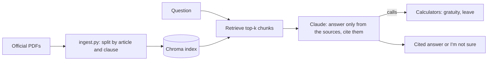

# UAE Payroll & Employment Assistant

A retrieval-augmented assistant that answers UAE private-sector employment questions (leave, notice, end-of-service, working hours, public holidays, unemployment insurance) **with article-level citations**, does its calculations with deterministic tools instead of the language model, and says "I'm not sure" when the sources don't cover the question.

> General information built as a software project. **Not legal advice.** Covers UAE federal private-sector law only (see [Limitations](#limitations)).

## Why this exists

HR teams and employees get inconsistent answers to payroll and leave questions, and a wrong figure has real consequences. The goal here is an assistant that is traceable (every claim points to an article), exact (numbers come from code, not from the model) and honest about what it doesn't know.

### Example

> **Q:** My monthly basic salary is AED 15,000 and I have completed exactly 4 years of full-time service. What end-of-service gratuity am I entitled to?

The model called `calculate_gratuity(basic_monthly_salary=15000, years_of_service=4)` and answered (abridged):

> Under UAE federal private-sector law, your end-of-service gratuity comes to **AED 42,000**.
> - A foreign full-time worker with at least one year of continuous service receives a gratuity based on basic wage. The rate is 21 days' wage for each year of the first five years [FDL 33/2021, Art. 51(2)(a)].
> - 84 days × AED 500 = **AED 42,000**. The cap did not apply. The total gratuity cannot exceed two years' wage [FDL 33/2021, Art. 51(6)].
> - **Basic wage:** The calculation uses your last basic wage received, not allowances [FDL 33/2021, Art. 51(5)].
> - **Unpaid absence:** Days of unpaid absence are not counted as service [FDL 33/2021, Art. 51(4)].
>
> This is general information, not legal advice.

And when the question is outside its sources (*"I work in a DIFC company. How many days of annual leave do I get?"*):

> I'm not sure. You work in the DIFC, which is a free zone, and my sources cover only UAE federal private-sector law. They don't cover the DIFC regime, so I can't apply the federal annual leave rules to you.

Both are verbatim from evaluation run R4 (`TOP_K=10`).

## How it works



1. **Ingestion** (`pipeline/ingest.py`): splits each legal PDF at article headings and, for long articles, at numbered clauses. Every chunk keeps its citation (for example `FDL 33/2021, Art. 29(1)-(2)`), page and source file. It handles PDF quirks found in the real documents, such as mirrored brackets in headings and running page footers.
2. **Index** (`pipeline/build_index.py`): embeds the chunks into a local Chroma store with metadata (document, article, jurisdiction).
3. **Answering** (`app/answer.py`): retrieves the top-k chunks (`TOP_K`, default 10) and asks Claude to answer *only* from them, cite them by label, and abstain when the sources don't cover the question.
4. **Tools** (`app/tools.py`): end-of-service gratuity and first-year leave accrual are computed in code and covered by unit tests.
5. **API** (`app/main.py`): a single `POST /ask` endpoint (FastAPI).

## Quickstart

```bash
python -m venv .venv && source .venv/bin/activate
pip install -r requirements.txt
cp env.example .env             # then add your ANTHROPIC_API_KEY
export $(grep -v '^#' .env | xargs)

# 1. Build the index from the PDFs in data/raw/ (one command per document)
python pipeline/ingest.py data/raw/decree_law_33_2021.pdf --doc-id fdl-33-2021 \
  --doc-title "Federal Decree-Law No. 33 of 2021 (as amended)" --short "FDL 33/2021"
python pipeline/ingest.py data/raw/cabinet_resolucion_1_2022.pdf --doc-id cr-1-2022 \
  --doc-title "Cabinet Resolution No. 1 of 2022 (Executive Regulations)" --short "CR 1/2022"
python pipeline/ingest.py data/raw/cabinet_resolucion_27_2024.pdf --doc-id cr-27-2024 \
  --doc-title "Cabinet Resolution No. 27 of 2024 (Public Holidays)" --short "CR 27/2024"
python pipeline/ingest.py data/raw/cabinet_resolucion_97_2022.pdf --doc-id cr-97-2022 \
  --doc-title "Cabinet Resolution No. 97 of 2022 (Unemployment Insurance Mechanisms)" --short "CR 97/2022"
python pipeline/ingest.py data/raw/decree_law_13_2022.pdf --doc-id fdl-13-2022 \
  --doc-title "Federal Decree-Law No. 13 of 2022 (Unemployment Insurance)" --short "FDL 13/2022"
python pipeline/build_index.py

# 2. Ask a question
python -m app.answer "How many days of sick leave do I get?"

# 3. Or run the API and open http://127.0.0.1:8000/docs
uvicorn app.main:app --reload
```

Run the unit tests with `pytest`. The evaluation calls the API: `python evals/run_evals.py` (development set) or `python evals/run_evals.py --file evals/heldout_questions.json` (held-out set). `python evals/run_retrieval.py` checks retrieval only and is free.

## Project structure

```
data/raw/          original PDFs (never edited)        data/processed/  chunks (generated)
data/index/        Chroma store (generated)
pipeline/          ingest.py, build_index.py
app/               answer.py, tools.py, main.py
evals/             seed_questions.json, heldout_questions.json, run_evals.py,
                   run_retrieval.py, RESULTS.md (experiment log), results/
tests/             calculator unit tests
```

## Evaluation

The questions were written, with expected answers and exact article references, **before** the assistant was built (`evals/seed_questions.json`). `python evals/run_evals.py` runs them and reports retrieval, citation, numeric and abstention checks, plus an LLM judge that grades required facts. Every run and every test change is logged in [`evals/RESULTS.md`](evals/RESULTS.md).

**Development set (18 questions, also used while building):**

| Run | Setup | Overall | Retrieval recall | Cites expected article | Required facts |
|---|---|---|---|---|---|
| R0b | top 5, original tests | 12 / 18 (67%) | 83% | 92% | 89% |
| R2b | top 10, original tests | 12 / 18 (67%) | 96% | 100% | 87% |
| R3 | top 5, corrected tests, fixed judge parser | 15 / 18 (83%) | 85% | 92% | 93% |
| R4 | top 10, corrected tests, tool-call judge | 18 / 18 (100%) | 96% | 100% | 100% |

**Held-out set (12 questions, written later and never used for tuning), run once:**

| Run | Setup | Overall | Retrieval recall | Cites expected article | No fake citations | Required facts |
|---|---|---|---|---|---|---|
| H1 | top 10, same system as R4 | **11 / 12 (92%)** | 91% | 100% | 100% | 96% |

The held-out set covers rewordings in everyday language, gratuity above five years with a part year, a salary quoted with allowances (gratuity must use basic only), service under one year, two- and three-article questions, a minimum-wage question where the sources have no figure, an income-tax question and an ADGM question (both must abstain). The single failure (unemployment cap) is a retrieval miss: the article defining the salary categories was not retrieved, and the model correctly said it could not tell which cap applied. The answer was also cut off mid-sentence (see the known issue below).

**What this shows**
- Retrieving 10 chunks instead of 5 lifts retrieval recall from 83-85% to 96% and fixes the visa question, where the law says "work permit" and the question says "visa".
- Most early failures were in the **tests and the judge**, not the assistant: expected facts from a web page outside the corpus, an incidental fact, compound facts graded as one, and an unparseable judge reply that was silently dropped. Each fix is logged with its reason in [`evals/RESULTS.md`](evals/RESULTS.md#test-changes).
- Numeric answers, calculator use, abstentions and citation hygiene (no fabricated citations) were solid throughout.

**Read these numbers with care:** 18/18 is a development score. Between R3 and R4, k, the judge and two tests all changed, so the jump is not attributable to k alone (a clean k=5 re-run is planned). Two tests were rewritten after failing, which is disclosed in the log. The held-out score is the one to trust.

**Known issue found by the held-out run:** several answers, in both sets, were cut off mid-sentence. The likely cause is the 1,000-token answer limit. Some earlier fact-04 and hol-01 failures were probably this, not the tests.

## Design decisions

- **Chunk by the document's structure** (article, then clause), not by fixed size, so citations are exact and clauses aren't split in half.
- **Calculations are tools**, not model output, so numeric answers are exact and testable.
- **Abstain by default**: if the retrieved text doesn't answer the question, say so. Personal data (your pay, your raise) is never guessed.
- **State the jurisdiction**: answers assume federal private-sector law, and DIFC/ADGM questions are declined rather than answered with the wrong regime.
- **Evaluate before building**, and evaluate each layer (retrieval, answer, citation, abstention) separately. Diagnose whether a failure is retrieval, generation or the test itself before changing anything.

## Limitations

- UAE federal private-sector law only. Free-zone regimes (DIFC, ADGM) are out of scope for v1.
- Corpus is a snapshot of the documents listed below; laws are amended, so check for newer versions.
- Islamic holiday dates are expected dates until officially announced, and the corpus has no source for when dates are announced.
- Retrieval is plain embedding search (MiniLM). Some questions phrased in everyday words only reach the right article at rank 7-9, which is why k=10 is the default.
- The evaluation judge is the same model family as the generator and is not deterministic; scores can vary slightly between identical runs.
- No login, UI, or deployment.

## Roadmap

- [x] Fix the judge parser and the incorrect tests, then re-run on the corrected set
- [x] Held-out eval set, reported separately (H1: 11/12)
- [ ] Re-ranking: retrieve about 20, re-rank locally with a cross-encoder, send the best 5
- [ ] Query rewriting and hybrid (keyword + embedding) retrieval if recall problems remain
- [ ] Hijri-to-Gregorian date tool for approximate holiday dates
- [ ] Add the official public-holidays government page to the corpus
- [ ] DIFC employment law as a second jurisdiction with metadata filtering
- [ ] Compare another embedding model on the legal text
- [ ] Simple web UI and deployment

## Sources

| Document | Official page | Downloaded |
|---|---|---|
| Federal Decree-Law No. 33 of 2021 (employment relations, as amended) | https://www.uaelegislation.gov.ae/en/legislations/1541 | 2026-10-14 |
| Cabinet Resolution No. 1 of 2022 (Executive Regulations) | https://www.uaelegislation.gov.ae/en/legislations/1547 | 2026-10-14 |
| Cabinet Resolution No. 27 of 2024 (public holidays) | https://www.uaelegislation.gov.ae/en/legislations/2595 | 2026-10-14 |
| Federal Decree-Law No. 13 of 2022 (unemployment insurance) | https://uaelegislation.gov.ae/en/legislations/1596 | 2026-11-18 |
| Cabinet Resolution No. 97 of 2022 (unemployment insurance mechanisms) | https://uaelegislation.gov.ae/en/legislations/1599 | 2026-10-14 |